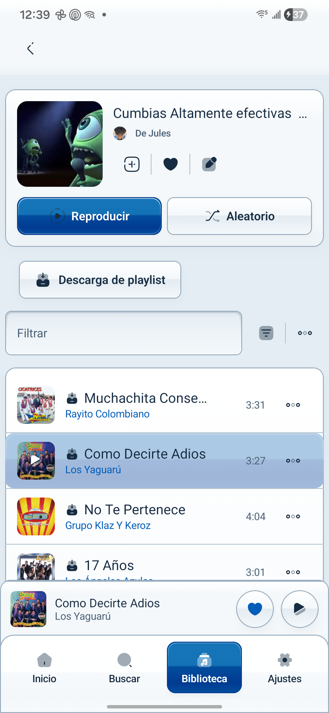
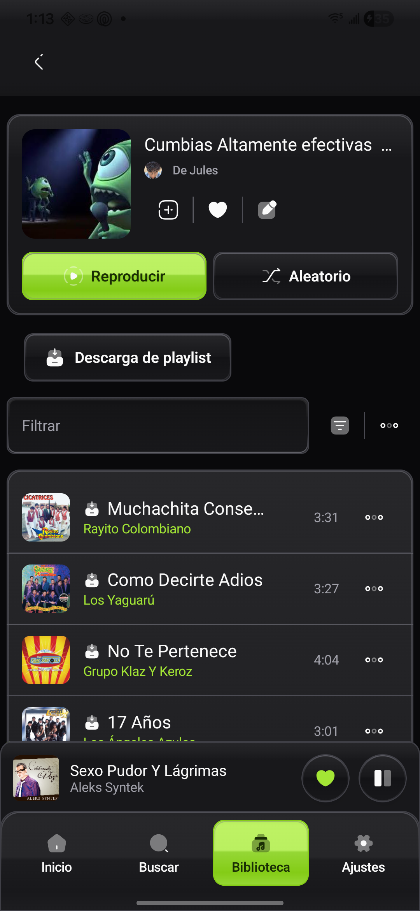

# Spotube 2.0

Edición comunitaria no oficial para Android, basada en [Spotube v6.0.0](https://github.com/team-spotube/spotube/releases/tag/v6.0.0). **2.0** identifica esta publicación del repositorio. El APK conserva la versión interna 6.0.0 y el identificador de la aplicación.

## Qué añade

- **Biblioteca sin conexión.** Guarda en el dispositivo el índice de playlists y las páginas consultadas de Me gusta y de las playlists. Ábrelas con conexión al menos una vez para que puedan aparecer sin internet.
- **Reproducción local primero.** Spotube consulta las descargas antes de usar el proveedor. Sin conexión, carga en la cola las pistas que puede reproducir desde un archivo local.
- **Indicador y progreso por canción.** Las pistas reconocidas muestran el icono de descarga y las descargas activas muestran una barra de progreso.
- **Descargas automáticas.** Una canción nueva en Me gusta entra en la cola si falta su archivo. Cada playlist tiene un botón para activar su descarga y mantenerla al día mientras Spotube está en ejecución, con opción de usar solo Wi-Fi en Android.
- **Reutilización de archivos.** Si el nombre ya existe, Spotube evita sobrescribirlo. Cuando los archivos son idénticos, conserva una sola copia y recuerda su asociación con la canción.
- **Tema Verde oscuro.** Disponible en Ajustes → Apariencia → Tema.
- **Reproducción y estabilidad.** Reutiliza la cola cuando la fuente de la siguiente pista sigue siendo válida y corrige el cierre al guardar pantallas como Me gusta al pasar a segundo plano.

## Capturas de Android

| Descarga de playlist | Pistas disponibles sin conexión |
|:--:|:--:|
|  |  |

| Descarga automática solo por Wi-Fi | Tema Verde oscuro |
|:--:|:--:|
|  |  |

## Instalación y compilación

El APK de esta edición está disponible en [GitHub Releases](https://github.com/julesprog963-stack/spotube/releases/tag/v2.0). Esta descarga es para **Android ARM64** y es una compilación de depuración firmada con la clave de esta edición. Android permite actualizar una instalación previa de esta edición si comparte la firma. Una instalación oficial con otra firma puede requerir una desinstalación previa, que elimina los datos internos de esa instalación.

Para compilar, sigue los [requisitos del proyecto original](../../README.md). Esta edición se construyó con JDK 21, Rust 1.99.0, Android SDK 37.0 y NDK 28.2.13676358. Usa ComposeNativeWebview en la revisión indicada por el flujo de compilación de Spotube y disponible en el repositorio Maven local.

```sh
./gradlew :composeApp:assembleStableDebug \
  -Pandroid.injected.build.abi=arm64-v8a -Pandroid.injected.testOnly=false \
  -x :composeApp:copyAndroidAndroidArmV7Debug \
  -x :composeApp:copyAndroidAndroidX64Debug \
  -x :composeApp:copyAndroidAndroidX86Debug
```

El código se distribuye con la [licencia AGPL del proyecto](../../LICENSE).

## Agradecimientos

Gracias a **Kingkor Roy Tirtho**, al **equipo de Spotube** y a todas las personas que han contribuido al proyecto. Su trabajo hizo posible esta edición.

[Proyecto original y sus colaboradores](https://github.com/team-spotube/spotube)
