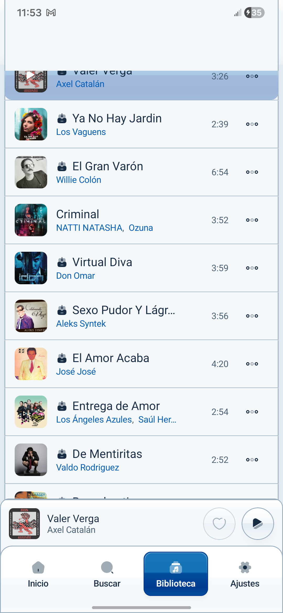
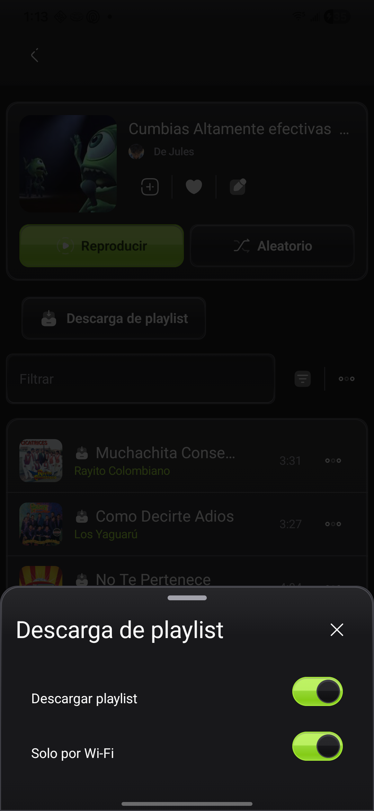

# Spotube 2.0

Edición comunitaria no oficial para Android, basada en [Spotube v6.0.0](https://github.com/team-spotube/spotube/releases/tag/v6.0.0). **2.0** identifica esta publicación del repositorio. El APK conserva la versión interna 6.0.0 y el identificador de la aplicación.

## Qué añade

- **Biblioteca sin conexión.** Guarda en el dispositivo el índice de playlists y las páginas consultadas de Me gusta y de las playlists. Ábrelas con conexión al menos una vez para que puedan aparecer sin internet.
- **Reproducción local primero.** Spotube consulta las descargas antes de usar el proveedor. Sin conexión, carga en la cola las pistas que puede reproducir desde un archivo local.
- **Indicador y progreso por canción.** Las pistas reconocidas muestran el icono de descarga y las descargas activas muestran una barra de progreso.
- **Descargas automáticas.** Una canción nueva en Me gusta entra en la cola si falta su archivo. Cada playlist tiene un botón para activar su descarga y mantenerla al día mientras Spotube está en ejecución, con opción de usar solo Wi-Fi en Android.
- **Reutilización de archivos.** Si el nombre ya existe, Spotube evita sobrescribirlo. Cuando los archivos son idénticos, conserva una sola copia y recuerda su asociación con la canción.
- **Tema Verde oscuro.** Disponible en Ajustes → Apariencia → Tema.
- **Reproducción y estabilidad.** Reutiliza la cola cuando la fuente de la siguiente pista sigue siendo válida y corrige el cierre al guardar pantallas como Me gusta al pasar a segundo plano.

## Cómo usar las funciones nuevas

1. **Escuchar sin internet.** Con conexión, abre Biblioteca → Playlists o Me gusta y deja cargar las páginas que quieras consultar luego. Cuando vuelvas sin internet, la biblioteca puede mostrar la copia guardada. Para escuchar una pista, busca el icono de descarga. El icono indica que Spotube reconoce un archivo local para esa entrada.
2. **Descargar una canción.** Abre su menú de tres puntos y elige **Descargar**. La barra en la fila muestra cuánto se ha transferido. En **Biblioteca → Descargas** puedes revisar las descargas activas, completadas y fallidas.
3. **Descargar y mantener una playlist.** Dentro de la playlist, toca el botón **Descargar playlist**, debajo de **Reproducir** y **Aleatorio**. Activa **Descargar playlist** en el panel. En Android, **Solo por Wi-Fi** viene activado al habilitar la descarga automática. Spotube descarga las pistas que le faltan y revisa periódicamente si hay nuevas mientras la app está en ejecución.
4. **Descargar al marcar Me gusta.** Al guardar una canción nueva en favoritos, Spotube intenta ponerla en la cola automáticamente si aún no reconoce un archivo local. Activar esta función en esta edición no inicia una descarga masiva de todos los favoritos anteriores.
5. **Cambiar el tema.** En **Ajustes → Apariencia → Tema**, selecciona **Verde oscuro**.

### Archivos de instalaciones anteriores

En Android, la carpeta predeterminada es `Download/Spotube`. Spotube puede reconocer archivos antiguos por título, artista, álbum y duración. Distintas ediciones de una canción pueden tener el mismo título y quedar asociadas a entradas separadas. Las descargas nuevas conservan el vínculo con la pista concreta, incluso cuando el proveedor entrega audio con una duración distinta. Si una descarga encuentra un destino existente, usa un nombre distinto y compara las dos copias. Si son idénticas, reutiliza el archivo original. Si los archivos difieren, conserva ambos.

### Qué se comprobó en Android

- El APK ARM64 se instaló y abrió en un Samsung Galaxy S22+.
- Me gusta abrió y reprodujo una canción descargada con Wi-Fi y datos móviles apagados.
- Una playlist de 89 pistas quedó disponible localmente. Spotube descargó 88 y reconoció la que ya estaba guardada.
- Al pasar Me gusta a segundo plano y volver tres veces, Spotube conservó la pantalla y no registró otro cierre. La corrección registra también las rutas de Letras, Control remoto y Ajustes de Jam.
- Al seleccionar otra pista de la misma playlist, Spotube reutilizó la cola cuando seguía siendo válida. El tiempo de inicio de pistas que requieren internet también depende del proveedor.

## Capturas de Android

| Descarga de playlist | Pistas disponibles sin conexión |
|:--:|:--:|
|  |  |

| Descarga automática solo por Wi-Fi | Tema Verde oscuro |
|:--:|:--:|
|  |  |

## Instalación y compilación

El APK de esta edición está disponible en [GitHub Releases](https://github.com/julesprog963-stack/spotube/releases/tag/v2.0). Esta descarga es para **Android ARM64** y es una compilación de depuración firmada con la clave de esta edición. Android permite actualizar una instalación previa de esta edición si comparte la firma. Una instalación oficial con otra firma puede requerir una desinstalación previa, que elimina los datos internos de esa instalación.

Para compilar, sigue los [requisitos del proyecto original](../../README.md). Esta edición se construyó con JDK 21, Rust 1.99.0, Android SDK 37.0 y NDK 28.2.13676358. Usa ComposeNativeWebview en la revisión indicada por el flujo de compilación de Spotube y disponible en el repositorio Maven local.

```sh
./gradlew :composeApp:assembleStableDebug \
  -Pandroid.injected.build.abi=arm64-v8a -Pandroid.injected.testOnly=false \
  -x :composeApp:copyAndroidAndroidArmV7Debug \
  -x :composeApp:copyAndroidAndroidX64Debug \
  -x :composeApp:copyAndroidAndroidX86Debug
```

El código se distribuye con la [licencia AGPL del proyecto](../../LICENSE).

## Agradecimientos

Gracias a **Kingkor Roy Tirtho**, al **equipo de Spotube** y a todas las personas que han contribuido al proyecto. Su trabajo hizo posible esta edición.

[Proyecto original y sus colaboradores](https://github.com/team-spotube/spotube)
